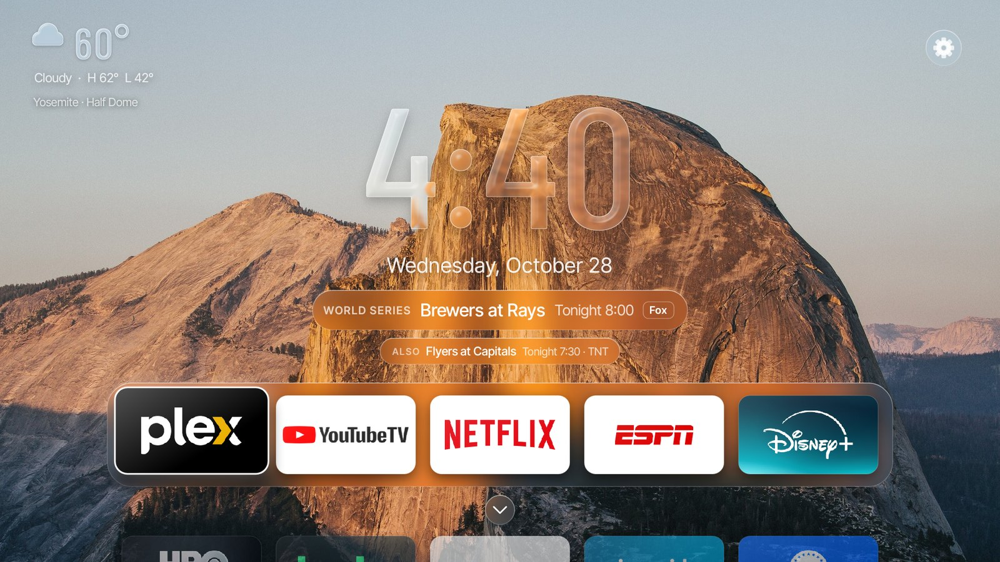
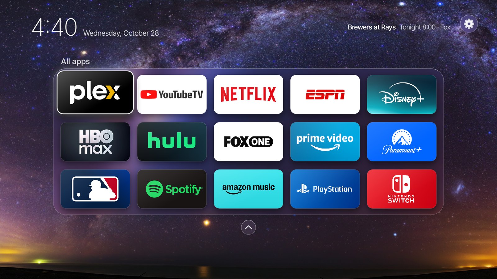
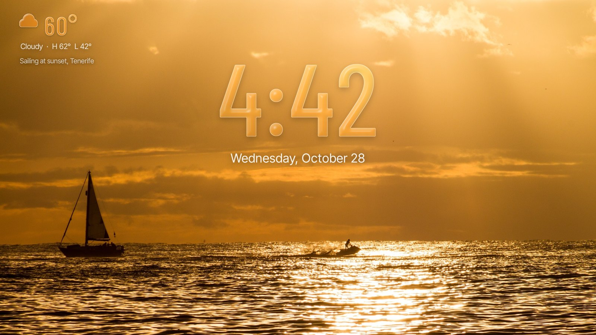
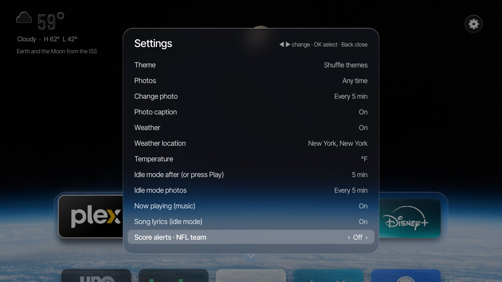
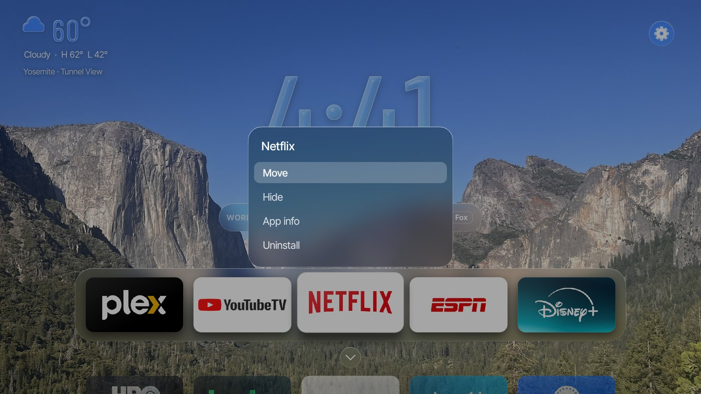
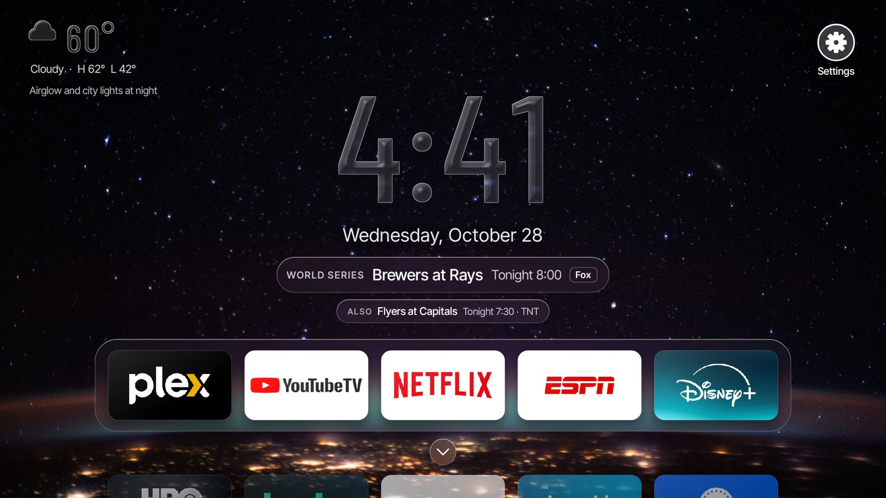
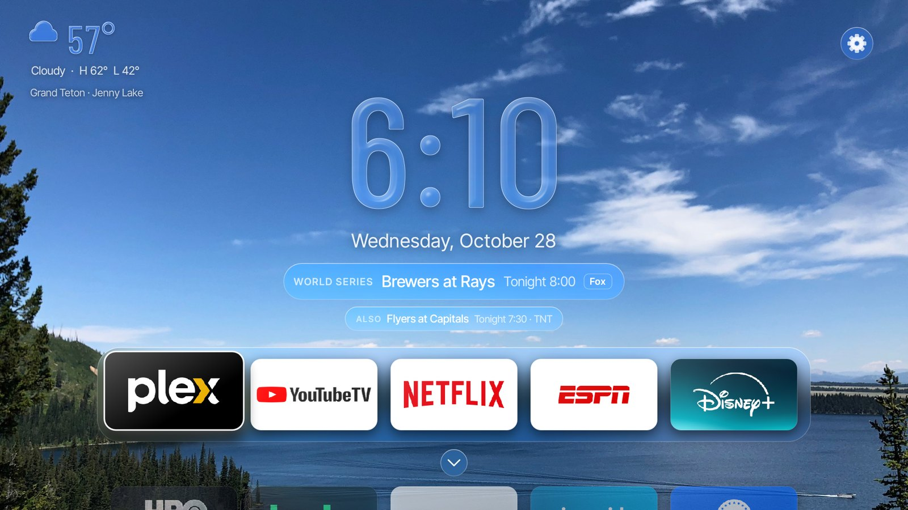
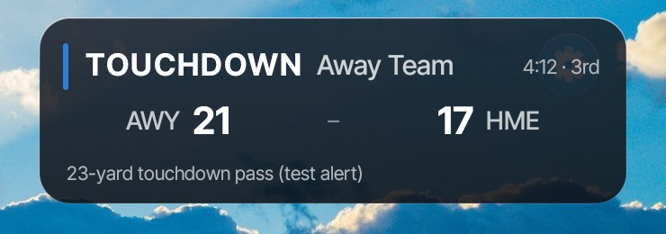

# Orbit

A home screen for Fire TV and Android TV: a liquid-glass clock over photos that follow the time of day, your apps on a glass shelf, and an idle mode that turns the TV into a photo frame with the song that's playing and its lyrics.



- **Glass clock and weather**, styled after the iOS 26 Lock Screen. The digits bend and frost the photo behind them.
- **Photo themes:** Orbit (the Earth from the ISS), National Parks and Ocean, 24 photos each. They follow your sunrise and sunset, changing at dawn, golden hour, dusk and night. You can also add your own [custom themes](#custom-themes).
- **App shelf:** your apps and your TV's HDMI inputs (PlayStation, Switch, Xbox…) as tiles you can reorder or hide.
- **Idle mode:** a photo frame that keeps the screen on, with the album art, the song and synced lyrics.
- **NFL score alerts:** a small banner over any app for your team's scores and close games.
- **Game line:** tonight's games with live scores, and OK starts the game in the right app (with [Sports Remote](https://github.com/jwizenfeld04/Sports-Remote), see below).

Plain Java, no Gradle and no Google Play Services. It builds in Docker.

## What you need, and what each piece adds

Orbit works on its own. A small helper on a home server, and Sports Remote, add the parts a TV app isn't allowed to do by itself.

| | Orbit alone | + home server running [tv-input-helper](https://github.com/jwizenfeld04/tv-input-helper) | + [Sports Remote](https://github.com/jwizenfeld04/Sports-Remote) |
|---|:-:|:-:|:-:|
| Clock, weather, photo themes, custom themes | ✓ | ✓ | ✓ |
| App shelf, idle mode, now playing, lyrics | ✓ | ✓ | ✓ |
| NFL score alerts over other apps | ✓ | ✓ | ✓ |
| **Home button opens Orbit** — Android TV / Google TV | ✓ (pick Orbit as home app) | ✓ | ✓ |
| **Home button opens Orbit** — Fire TV | slow (~5 s) or manual, [see below](#3-make-home-open-orbit) | ✓ fast (~0.7 s), kept running | ✓ |
| **HDMI input tiles** — Android TV / Google TV | ✓ (untested on a real TV) | ✓ | ✓ |
| **HDMI input tiles** — Fire TV | — | ✓ | ✓ |
| Wake a PS4 from Rest Mode before switching to it | — | ✓ | ✓ |
| Music app opened by Alexa or Spotify Connect jumps back to Orbit's idle mode (Fire TV) | — | ✓ | ✓ |
| **Game line:** tonight's NFL / MLB / NHL / NBA games with live scores | — | — | ✓ |
| OK on a game opens it in the right app (YouTube TV, ESPN, Peacock…) | — | — | ✓ |

**Why the server?** Fire OS only lets Amazon's own apps switch HDMI inputs or replace the Home button. A computer on your network can do both over ADB, Android's debugging connection, so tv-input-helper does it for Orbit. Any always-on machine works: a mini PC, a NAS that runs Docker, or a Raspberry Pi. Sports Remote runs on the same machine and knows which of your services shows each game.

### What Orbit can't do

- **It isn't in an app store.** You install it from a computer with ADB (below), and updates go the same way.
- **Fire TV still owns the Home button.** Even with the helper, Amazon's home screen flashes for a moment before Orbit comes back. Amazon's own rows, Live TV guide and profiles stay in Amazon's home, which you can still open.
- **Score alerts are NFL only**, from ESPN's public scoreboard. Banners don't show while the screen is off.
- **Now playing only sees music played on the TV.** It works with any app that reports what's playing to Android (Spotify, Amazon Music, Alexa, YouTube Music, Plex…). Music sent from your phone over Bluetooth straight to a soundbar can't be shown.
- **Lyrics come from LRCLIB**, a free community database. Songs it doesn't have show no lyrics.
- **Settings are per TV.** Each TV keeps its own, and there's no sync.
- **HDMI switching on Android TV / Google TV** uses the standard Android API and hasn't been tested on a real TV yet.

## Screens

| | |
|---|---|
|  **All apps.** ▼ on the shelf opens every app and input as a grid. |  **Idle mode.** After a few minutes, or ⏯ on the remote. With music playing, the album art, song and lyrics show over the photo. |
|  **Settings.** The gear in the top-right corner. ◀ ▶ change a value. |  **Tile menu.** Hold OK on a tile: Move, Hide, App info, Uninstall. |
|  **Game line** (with Sports Remote). Tonight's games and live scores under the date. |  **Photo themes.** National Parks at midday; the clock and panels pick up the photo's colors. |

Photos in the screenshots: Half Dome by Pierre Le Vaillant (CC0) and Tunnel View by EF5 (CC0), Yosemite; Milky Way over the Pacific by Paul Stewart (CC0); sailing at sunset, Tenerife, by TimOve (CC BY 2.0); Earth from the ISS by NASA (public domain); Jenny Lake, Grand Teton, by Z3lvs (CC0). Sources and licenses for every built-in photo are in `tools/themes.json`. App logos belong to their owners.

## Install

### 1. Build and install

On any computer with Docker and `adb`:

1. Turn on ADB debugging on the TV.
   - **Fire TV:** Settings → My Fire TV → About, click the device name 7 times, then Developer options → ADB debugging.
   - **Android TV / Google TV:** Settings → System → About, click "Android TV OS build" 7 times, then Developer options → USB debugging (and Wireless debugging on newer models).
2. Give the TV a fixed IP address (a DHCP reservation on your router).
3. Run `./setup-tv.sh <tv-ip>`. It builds Orbit, installs it, and grants its two one-time permissions: seeing what music is playing, and showing score alerts over other apps. Approve the ADB prompt on the TV and tick "Always allow". Add `--debloat` on a Fire TV to also turn off Amazon's shopping, ad and demo apps.

The first build downloads the Android build tools (about 1 GB, cached in `~/.cache/android-sdk`). To skip typing the TV's address, put `TV_IP=<tv-ip>` in a `.env` file in this folder (it's gitignored).

### 2. First launch: the setup screens

Open Orbit from the TV's app list. Six short screens cover everything specific to you:

| Screen | What you choose | Change later in Settings |
|---|---|---|
| Welcome | Start, or skip with the defaults | "Run setup again" |
| Choose your apps | Every app on the TV is listed; OK adds or removes one, in the order you pick. Phone-style apps (no TV version) are listed but start off the shelf. | Hold OK on a tile to Move or Hide it; "Show hidden apps" |
| TV inputs | What's on HDMI 1–4: Off, PlayStation, Xbox, Nintendo Switch, Apple TV, Cable box, Blu-ray, PC or Other. Each becomes a tile. | "TV input · HDMI 1" … "HDMI 4" |
| Weather and sunrise | Your city (guessed from your internet connection; OK to search), °F or °C, weather on or off. It also sets when photos change to dawn, golden hour and night. | "Weather location", "Temperature", "Weather" |
| Live sports | Optional: your home server's address, with a connection check. Skip it if you don't have one. | "Home server (game line)" |
| Make it yours | Theme, photos matching the time of day, how often they change, clock style | the same rows |

If you skip setup: every TV app is on the shelf (well-known streaming apps first, then A to Z), weather is off until you set a location (sunrise and sunset use New York's until then), there's no server, and the Orbit theme follows the time of day and changes every hour. Idle mode starts after 5 minutes, and the screen sleeps after 4 hours.

### 3. Make Home open Orbit

- **Android TV, Google TV, Nvidia Shield:** press Home and pick Orbit when asked, then "Always". If it doesn't ask, look in Settings → Apps → Default apps → Home app.
- **Fire TV:** Amazon always opens its own home screen, so something has to send Home to Orbit:
  - **With a home server (recommended):** run [tv-input-helper](https://github.com/jwizenfeld04/tv-input-helper). It keeps a small watcher script (`homewatch.sh`) running on the TV that opens Orbit about 0.7 s after Home, and restarts it after the TV reboots.
  - **Without a server, from a computer:** push and start the same script by hand, after setting `LAUNCHER=home.jw.orbit/.OrbitActivity` at its top. It stops when the TV restarts.
    ```bash
    adb push homewatch.sh /data/local/tmp/ && adb shell chmod 755 /data/local/tmp/homewatch.sh
    adb shell "nohup /data/local/tmp/homewatch.sh >/dev/null 2>&1 &"
    ```
  - **No computer at all:** install "Home on Fire" from its GitHub page, point it at Orbit and turn on "Replace Home button". It works, but Fire OS holds app launches for about 5 s after Home, so Amazon's screen shows first.

### 4. Optional: home server and Sports Remote

Install [tv-input-helper](https://github.com/jwizenfeld04/tv-input-helper) on an always-on machine, and [Sports Remote](https://github.com/jwizenfeld04/Sports-Remote) next to it for the game line. Then enter the helper's address (`<server-ip>:8788`) on the Live sports setup screen or in Settings → "Home server (game line)". The helper only answers the TV it's set up for.

## Using it

**Remote:** ◀ ▶ move along the shelf; ▼ opens all apps; ▲ reaches the game line and the gear. Hold OK on a tile for its menu. ⏯ plays and pauses music, or starts idle mode when nothing is playing; hold ⏯ to start or end idle mode. ◀◀ ▶▶ skip songs. The channel rocker (next to volume) changes the photo, on the home screen and in idle mode; any other key leaves idle mode.

**Now playing:** play music on the TV (or cast to it with Spotify Connect) and a small "song · artist" pill shows top right. In idle mode a glass card shows the album art, song, artist and progress, with the line being sung above it. "[Explicit]" and "(Clean)" tags are hidden.



**Score alerts:** pick your team in Settings → "Score alerts · NFL team". You get kickoff, every score (with the play when ESPN has it), halftime and the final. "Close NFL games" adds any game within 8 points in the last 5 minutes or overtime. Streaming TV runs behind real life, so alerts wait for the "delay" setting (default 30 s) to avoid spoilers. "Score alerts · test" shows a sample.

## Settings

Open them with the gear in the top-right corner. ◀ ▶ change a value, OK opens a row, Back closes.

| Setting | What it does |
|---|---|
| **Theme** | Orbit, National Parks, Ocean, any custom themes on the TV, or Shuffle themes. |
| Photos | Match the time of day, or always Dawn / Day / Golden hour / Dusk / Night, or Any time. |
| Change photo | Every 5 min, 15 min or hour, or Never. |
| Photo caption | Shows where the photo was taken, under the weather. |
| Weather · Weather location · Temperature | Weather on or off; your city (also sets sunrise and sunset); °F or °C. |
| Idle mode after (or press Play) | 2, 5, 10 or 15 minutes without a key press, or Never. |
| Idle mode photos | How often idle mode changes the photo, or like the home screen. |
| Now playing (music) | The song pill and the idle-mode music card. |
| Song lyrics (idle mode) | Synced lyrics above the music card. |
| Score alerts · NFL team / close NFL games / delay / test | See [Using it](#using-it). |
| Screen sleeps after | Orbit keeps the screen on for up to 1–12 hours since the last key press, or Never sleeps. |
| Clock weight · Glass strength · Clock · Date under clock | Light to Heavy digits; Clear, Normal or Frosted glass; 12- or 24-hour; the date line. |
| Game line · "Also" line · NFL / MLB / NHL / NBA games | The game line (with a home server), its second line, and which leagues it shows. |
| Dim wallpaper at night | Darkens the photo at night. |
| Show hidden apps · Reset app order | Bring hidden tiles back; go back to the default order. |
| TV input · HDMI 1–4 | What's plugged into each port; each becomes a tile. On Fire TV the tiles need the home server. |
| Open the old launcher (FLauncher) | Opens FLauncher, if it's installed, as a fallback home screen. |
| Home server (game line) | The helper's address, e.g. `<server-ip>:8788`. Empty = none. |
| Run setup again | The setup screens. |
| This photo · About | The current photo's credit and license; Orbit's version. |

## Custom themes

A custom theme is a set of your own photos that lives on the TV, not inside the app. Use it for photos you can't or don't want to publish: family pictures, your own travel photos, movie stills. Custom themes show up in Settings → Theme next to the built-in ones and are part of "Shuffle themes".

1. Make a folder with your photos and a `theme.json`:
   ```json
   {"id": "family", "name": "Family", "photos": [
     {"src": "src/beach-2025.jpg", "phase": "golden", "y": 0.5, "caption": "Cape Cod, summer 2025", "credit": "Our photos", "license": ""}]}
   ```
   - `id`: lowercase letters, digits, `-` or `_`; it can't be the same as a built-in theme.
   - `phase`: `dawn`, `day`, `golden`, `dusk` or `night`: when the photo shows with "Match time of day". Give each phase a few photos; a theme with none for the current phase falls back to all of its photos.
   - `y`: for photos taller than 16:9, where to crop, from 0 (top) to 1 (bottom).
   - `caption`, `credit`, `license`: shown under the weather and in Settings → "This photo".
   - Each photo's id is its file name without the extension (`src/beach-2025.jpg` → `beach-2025`), so file names must be unique within a theme and use only letters, digits, `-` or `_`. JPEG and PNG both work; anything smaller than 1920×1080 is scaled up.
2. Run `tools/custom_theme.sh <folder> [tv-ip]`. It makes the wallpaper, blurred and clock versions of each photo (in Docker), copies them to the TV and restarts Orbit.
3. `tools/custom_theme.sh --list` shows the custom themes on the TV; `--remove <id>` deletes one.

**Picking photos that work behind the clock:** the glass clock covers the upper middle of the screen, and the app shelf the bottom third. Photos look best with sky, water or a calm background in the middle and the subject off to the left or right. Faces, scoreboards or busy detail right behind the digits make the time hard to read. To check a photo on the real TV:

```bash
adb shell am start -n home.jw.orbit/.OrbitActivity --es snapshot check --es photo <theme-id>/<photo-id>
adb pull /sdcard/Android/data/home.jw.orbit/files/check.png   # wait a few seconds for the file to finish
```

Custom themes are stored in `/sdcard/Android/data/home.jw.orbit/files/themes/<id>/`. Uninstalling Orbit or a factory reset deletes them, so keep your folders and run `custom_theme.sh` again.

## Privacy

Orbit has no account, analytics or ads. It talks to:
- **Open-Meteo:** weather and the city search (no key).
- **ip-api.com,** falling back to **ipapi.co:** only on the setup screen, to guess your city.
- **ESPN's public scoreboard:** only if score alerts are on.
- **LRCLIB:** the title, artist, album and length of the song that's playing, when lyrics are on.
- **Your home server:** only if you set one.

The music permission lets Orbit see what's playing, not your notifications.

## Development

- **Build and install:** `./deploy.sh [tv-ip]` (about a minute). Code is in `app/src/home/jw/orbit/`.
- **Built-in photos:** originals in `assets/wallpapers/<theme>/src/`, listed in `tools/themes.json` (same fields as a custom theme, plus `url`). Run `tools/build_assets.sh`, then `./deploy.sh`. Built-in photos must be public domain, CC0, CC BY or CC BY-SA, with the credit recorded.
- **Glass digits:** `tools/glass_glyphs.py`; `tools/preview_glass.py` renders the clock over a photo without a TV.
- **Snapshot hook:** `adb shell am start -n home.jw.orbit/.OrbitActivity --es snapshot <name>` saves the screen to `/sdcard/Android/data/home.jw.orbit/files/<name>.png`. Options: `--es photo <theme>/<id>`, `--es phase night`, `--ez expand true` (all apps), `--ez settings true`, `--ez menu true`, `--ei focus <n>`, `--ez idleMode true`. Test a score alert with `--ez testAlert true`.
- **Changes and releases:** every change goes through a pull request with a `CHANGELOG.md` entry; releases are tags with the signed APK attached. See [RELEASING.md](RELEASING.md).
- **Signing key:** `keys/` (gitignored) holds the key; the first build creates it. Keep a safe copy: an installed Orbit only accepts updates signed with the same key.

```
app/        AndroidManifest.xml, build.sh, src/ (Java), res/, assets/ (built wallpapers, glass digits, fonts)
assets/     original photos, per theme
tools/      themes.json, make_assets.py, build_assets.sh, custom_theme.sh, glass_glyphs.py, preview_glass.py, fonts/
scripts/    release.sh, tv-ip.sh
deploy.sh   build + install        setup-tv.sh   first-time TV setup
```

## Credits and license

Orbit's code is MIT licensed ([LICENSE](LICENSE)). The photos are not: each stays under its own license (public domain, CC0, CC BY or CC BY-SA), with the photographer, license and source in `tools/themes.json` and on the TV under Settings → "This photo"; the built wallpapers are cropped, scaled and blurred versions of those originals. The Orbit theme is NASA imagery (public domain). Fonts: Inter Tight and Barlow Condensed (SIL Open Font License, in `tools/fonts/`). Weather by Open-Meteo, lyrics by LRCLIB, scores from ESPN.
